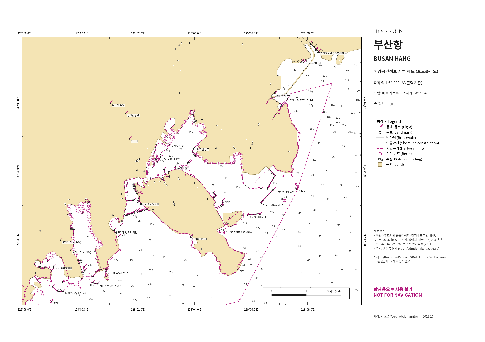

# 부산항 해양공간정보 DB 구축 및 해도·등대표 제작

**Busan Port Marine Spatial Database, Chart & Light List** — 국립해양조사원 공개 전자해도 기반 데이터를 이용한 개인 포트폴리오 프로젝트



## 개요

국립해양조사원(KHOA)이 공공데이터포털에 공개한 전자해도(ENC) 기반 SHP 데이터를 수집·정제하여 부산항 해역의 해양공간정보 DB를 구축하고, 이를 이용해 해도 양식 지도와 항해용 간행물(등대표)을 자동으로 제작했습니다.

| 업무 | 결과물 |
|---|---|
| 해양공간정보 DB 구축 | `output/busan_marine.gpkg` — S-57 객체 코드 기준 7개 레이어 + 메타·품질검사 테이블 |
| 품질검사 (QC) | `output/qa_report.md` — 기하 유효성, 좌표 범위, 중복, 속성 누락, 좌표계 불일치 검사 |
| 해도 제작 | `output/busan_port_chart.pdf` — A3, 메르카토르 도법, 해도 관례 색상·기호, 경위도 분 눈금 |
| 항해용 간행물 제작 | `output/busan_light_list.pdf / .csv` — 등대 83기, 서→동 순 등대표 |
| QGIS 연동 | `styles/*.qml` + GeoPackage `layer_styles` — QGIS에서 열면 해도 스타일 자동 적용 |

## 처리 흐름

```
KHOA SHP (전국)  ──►  build_db.py  ──►  busan_marine.gpkg  ──►  make_chart.py       ──►  해도 PDF/PNG
 9개 데이터셋        · 좌표계 통일 (EPSG:5179)    · LNDMRK  등대·육표      make_light_list.py ──►  등대표 PDF/CSV
                     · 부산항 해역 추출            · SLCONS  인공안선        make_qgis_styles.py ──► QGIS 스타일
                     · 속성 정제·코드 해석         · BERTHS  선석
                     · 품질검사 → qa_report       · SOUNDG  수심 …
```

## 데이터

| S-57 코드 | 국문명 | 원본 테이블 | 전국 | 부산항 |
|---|---|---|---:|---:|
| LNDMRK | 육표·등대 | VI_LNDMRK_P | 3,214 | 160 |
| BERTHS | 선석 | VI_BERTHS_P | 506 | 90 |
| ACHARE | 정박지 | VI_ACHARE_P | 5 | 1 |
| HRBARE | 항만구역 | VI_HRBARE_A | 70 | 1 |
| SLCONS | 인공안선 | VI_SLCONS_L | 17,424 | 516 |
| SOUNDG | 수심 | WGIS_DEPTHWATER (1/25,000 연안정보도) | 46,270 | 231 |
| LNDARE | 육지 (배경) | 행정동 경계 (vuski/admdongkor) | — | 1 |

부등(LITFLT), 일반항로(FAIRWY), 암초(UWTROC)도 처리 대상이지만 부산항 해역 내 객체가 없어 적재되지 않았습니다.

## 품질검사에서 확인한 주요 사항

- **해역 범위 밖 객체 864건 (육표)** — 처음엔 좌표 오류로 의심했으나, 전자해도 번호로 분류해 보니 소축척 개관도(KR1W, 일본·러시아 연안 등대 등)와 북측 해역(KR3G)의 정상 객체였습니다. 오류가 아니라 범위 필터가 필요한 데이터로 판단했습니다.
- **좌표계 불일치** — 수심 데이터는 사용자 정의 UTM-K(WGS84 타원체)로, 다른 레이어(EPSG:5179)와 정의가 달라 통일했습니다.
- **코드 해석 검증** — KHOA 코드(`CTC001` 등)의 숫자를 S-57 속성값으로 해석했습니다. 명칭에 '방파제'가 들어간 등대를 가장 가까운 인공안선과 매칭해 보니, 구분 코드가 있는 23개 중 20개가 `CTC001`(방파제)이었습니다.
- **속성 누락** — 등대 고도·높이(ELEVAT/HEIGHT) 160건 전부, 선석 최소수심(DRVAL1) 90건 전부 누락. 동일 명칭 중복 등대 2건(남항대교 충돌방지 PR8, PR9).

전체 결과: [`output/qa_report.md`](output/qa_report.md)

## 실행 방법

```bash
pip install geopandas pyogrio matplotlib
./run_all.sh "<국립해양조사원 SHP를 내려받은 폴더>"
```

원본 데이터: 공공데이터포털(data.go.kr)에서 "국립해양조사원_등대", "_부등", "_선석", "_정박지(점)", "_항만구역", "_일반항로", "_인공안선(선)", "_암초", "해양수산부_1/25,000 연안정보도(수심)"을 내려받아 한 폴더에 압축 해제합니다. 스크립트는 테이블명(`VI_LNDMRK_P.shp` 등)으로 파일을 찾습니다.

QGIS: `output/busan_marine.gpkg`를 QGIS로 끌어다 놓으면 레이어별 해도 스타일이 자동 적용됩니다. (`styles/` 폴더의 QML을 직접 불러올 수도 있습니다.)

## 사용 기술

Python · GeoPandas · GDAL/OGR (pyogrio) · Shapely · pyproj · Matplotlib · SQLite/GeoPackage · QGIS (QML) · IHO S-57 객체 카탈로그

## 한계

- 수심은 2011년 자료이며 최신 측량과 다를 수 있습니다.
- 등질(등광 특성)·광달거리 등 LIGHTS 객체 속성은 공개 데이터에 없어 등대표에 포함하지 않았습니다.
- 육지 배경은 행정 경계 기반이므로 해안선과 정확히 일치하지 않습니다.
- **포트폴리오용 결과물이며 항해용으로 사용할 수 없습니다.**

---

**English summary.** An end-to-end marine GIS pipeline: national KHOA (Korea Hydrographic and Oceanographic Agency) ENC-derived shapefiles are reprojected, clipped to Busan Port, cleaned, decoded to IHO S-57 object/attribute codes, quality-checked, and loaded into a GeoPackage; the database then drives an A3 chart-style map (Mercator, chart symbology) and an auto-generated light list. Author: Axror Abduhamitov, 2026.
